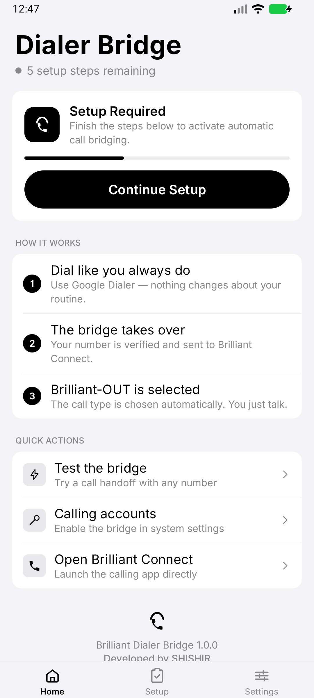
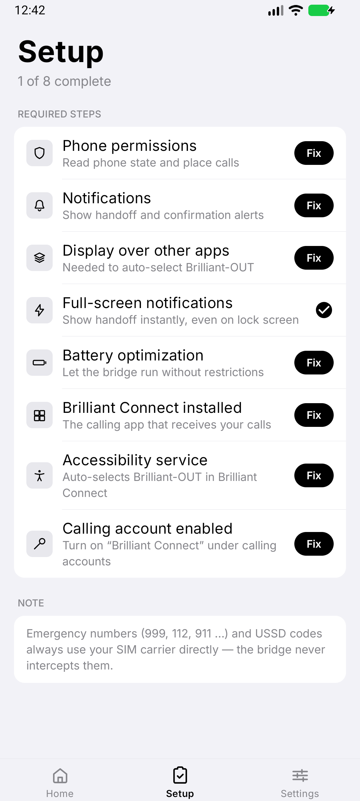
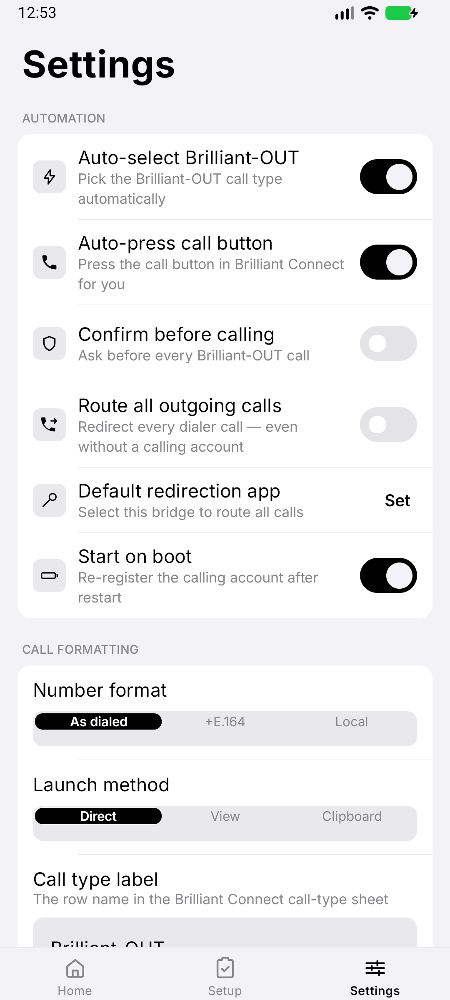
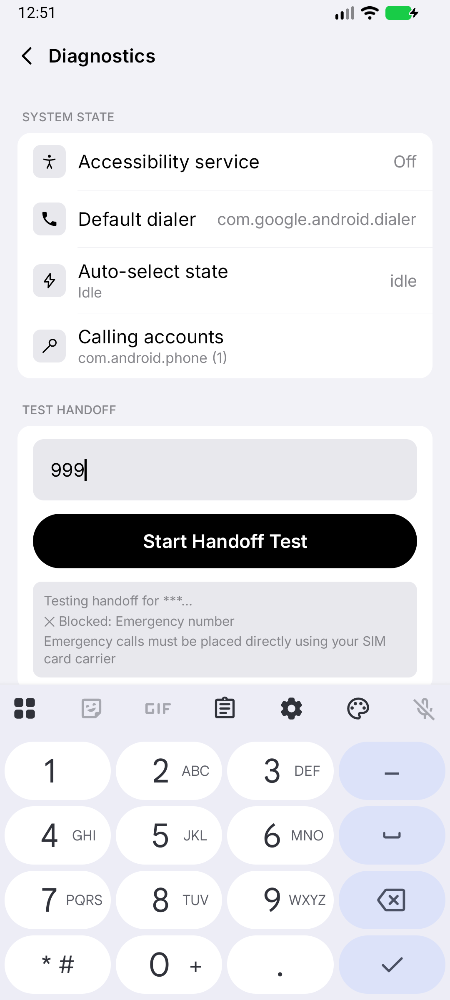
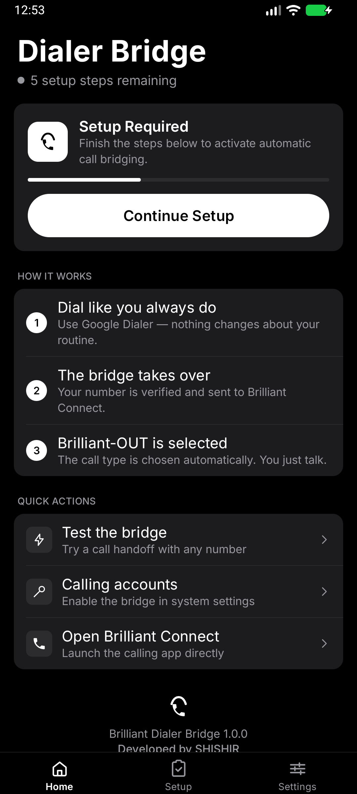
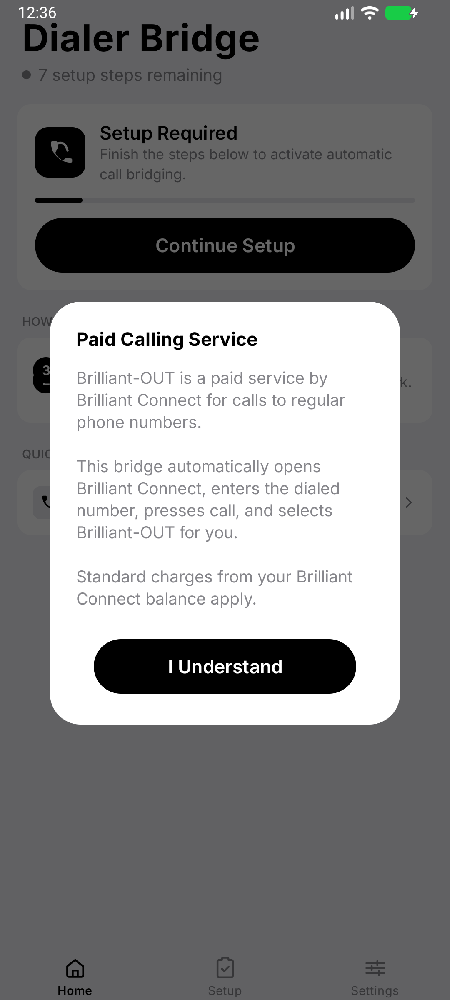
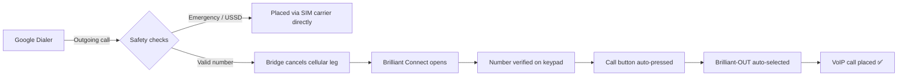

<div align="center">

# 📞 Brilliant Dialer Bridge

**Bridge the Google Dialer to Brilliant Connect — automatic VoIP call handoff with zero taps.**

[](../../releases/latest)
[](https://developer.android.com/about/versions/oreo)
[](https://kotlinlang.org)
[](https://developer.android.com/jetpack/compose)
[](LICENSE)
[](../../releases/latest)

*A minimal, iOS-inspired black & white Android app. Developed by [SHISHIR](https://github.com/Shishir-ip).*

</div>

---

## ✨ What is it?

**Brilliant Dialer Bridge** connects the **Google Dialer** (or any default phone dialer) to the **Brilliant Connect** VoIP app. Instead of juggling two apps and hunting for the right call type, you simply:

1. 📱 **Dial normally** in Google Dialer — nothing changes about your routine
2. 🔁 **The bridge takes over** — your number is verified and sent to Brilliant Connect
3. ⚡ **Brilliant-OUT is selected automatically** — the call is placed for you. You just talk.

No more manual number re-entry, no more hunting through call-type sheets. One dial, done.

> 💡 **Best of all:** it's completely free & open source — you only pay for the Brilliant Connect call charges you'd pay anyway.

## 🖼️ Screenshots

| Home | Setup | Settings |
|:---:|:---:|:---:|
|  |  |  |

| Diagnostics | Dark Mode | First Run |
|:---:|:---:|:---:|
|  |  |  |

## 🚀 Installation

### Download (recommended)

Grab the latest signed APK from the [**Releases**](../../releases/latest) page:

1. Download `BrilliantDialerBridge-v1.0.0.apk`
2. Open it on your phone (Android 8.0+)
3. Allow "Install from unknown sources" when prompted
4. Follow the in-app **Setup** guide (8 quick steps)

### Build from source

```bash
git clone https://github.com/Shishir-ip/Brilliant-Connect-Dialer-Bridge-App.git
cd Brilliant-Connect-Dialer-Bridge-App
./gradlew assembleRelease        # requires Android SDK + a release keystore
./gradlew assembleDebug          # debug build, no keystore needed
./gradlew testDebugUnitTest      # run unit tests
```

## 🛠️ Setup Guide

The app walks you through everything with a one-tap **Fix** button for each step:

| Step | Why it's needed |
|---|---|
| **Phone permissions** | Read the dialed number and manage the calling account |
| **Notifications** | Show handoff and confirmation alerts |
| **Display over other apps** | Automate the Brilliant Connect screen |
| **Full-screen notifications** | Show handoff instantly, even on the lock screen |
| **Battery optimization** | Keep the bridge alive in the background |
| **Brilliant Connect installed** | The VoIP app that actually places the call |
| **Accessibility service** | Auto-selects **Brilliant-OUT** inside Brilliant Connect |
| **Calling account enabled** | Registers "Brilliant Connect" as a calling account — on Oppo/Realme/OnePlus, use the **Use call redirection** option in this step instead |

## 🧠 How it works



Under the hood the app uses the **Android Telecom framework** (`ConnectionService` + `PhoneAccount`), an optional **CallRedirectionService**, and an **AccessibilityService** that verifies the dialed digits on Brilliant Connect's keypad *before* pressing call — so the wrong number is never dialed.

## 🛡️ Safety first

- **Emergency numbers** (999, 112, 911, 000, …) are **never** intercepted — they always go through your SIM carrier
- **USSD codes** (`*123#` etc.) are **never** routed through VoIP
- **Number verification**: the keypad digits are cross-checked against the dialed number before any automation
- **Optional confirmation** step before every paid call
- All logs are **masked** — full numbers never appear in the in-app log viewer

## ⚙️ Features

- ✅ **Auto handoff** — dial from Google Dialer, call lands in Brilliant Connect
- ✅ **Auto-select Brilliant-OUT** — no manual call-type selection
- ✅ **Auto-press call button** — fully hands-free dialing
- ✅ **Confirm-before-call mode** — a notification asks you first
- ✅ **Route all outgoing calls** — works even without a calling account, via call redirection
- ✅ **Number formats** — as dialed, E.164 (+880…), or local (01…)
- ✅ **Re-registers after reboot** — set-and-forget
- ✅ **Built-in diagnostics** — live state, test handoff tool, masked logs
- ✅ **Black & white iOS-inspired UI** — pure OLED black in dark mode, 1.8 MB APK

## 📱 Requirements

| | |
|---|---|
| **OS** | Android 8.0 (API 26) or newer |
| **Tested** | Android 8 → 17 |
| **Dialer** | Google Dialer or any stock dialer |
| **VoIP app** | [Brilliant Connect](https://play.google.com/store/apps/details?id=com.brilliant.connect.com.bd) |

## 🧱 Tech stack

| Layer | Technology |
|---|---|
| Language | Kotlin 2.2 |
| UI | Jetpack Compose + Material 3 (custom monochrome theme) |
| Architecture | MVVM + StateFlow + DataStore |
| Telecom | ConnectionService, PhoneAccount, CallRedirectionService |
| Automation | AccessibilityService with node + gesture fallback |
| Build | Gradle 9.3, AGP 9.1, R8 minified & resource-shrunk |

## 🔏 Signing

Release builds are signed with a local keystore that is **not committed** to this repository. To build a signed release yourself, create `keystore.properties` in the project root:

```properties
storeFile=release.keystore
storePassword=yourStorePassword
keyAlias=yourAlias
keyPassword=yourKeyPassword
```

Generate a keystore with:

```bash
keytool -genkeypair -v -keystore release.keystore -alias yourAlias \
  -keyalg RSA -keysize 4096 -validity 10000
```

## ❓ FAQ

<details>
<summary><b>Oppo / Realme / OnePlus: "Brilliant Connect" doesn't appear under calling accounts?</b></summary>
ColorOS often hides third-party calling accounts entirely, so there is nothing to toggle. Use the built-in **call redirection** route instead: in <b>Setup</b>, tap <b>Fix</b> on the last step → <b>“Use call redirection”</b> → accept the system prompt, and turn on <b>Route all outgoing calls</b> in Settings. This routes every dialer call through the bridge <i>without</i> needing a calling account. Also enable <b>Auto-start</b> for the bridge in ColorOS app info so it survives reboots.
</details>

<details>
<summary><b>Does this cost extra money?</b></summary>
No. The bridge itself is free and open source. Calls placed via Brilliant-OUT use your normal Brilliant Connect balance, exactly as if you had dialed manually.
</details>

<details>
<summary><b>Can it dial a wrong number?</b></summary>
No — the accessibility controller compares the digits shown in Brilliant Connect's keypad against the number you dialed. If they don't match, it aborts and tells you.
</details>

<details>
<summary><b>Will emergency calls still work?</b></summary>
Yes. Emergency numbers are detected and immediately handed back to your SIM carrier, untouched.
</details>

<details>
<summary><b>Does it work without Brilliant Connect?</b></summary>
The bridge detects when Brilliant Connect is missing and sends you straight to its Play Store page.
</details>

<details>
<summary><b>Why do my calls show as "ended" for a split second?</b></summary>
Android Telecom requires the bridge to acknowledge the outgoing call before handing it off. The call "moves" from the dialer into Brilliant Connect — that flicker is the handoff.
</details>

## ⚠️ Disclaimer

This project is an independent, open-source utility and is **not affiliated with, endorsed by, or connected to Brilliant Connect** or its operators. Use in accordance with the terms of service of your VoIP provider.

## 🤝 Contributing

Issues and pull requests are welcome! For significant changes, please open an issue first to discuss what you'd like to change.

1. Fork the repository
2. Create your feature branch (`git checkout -b feature/amazing-feature`)
3. Commit your changes (`git commit -m 'Add amazing feature'`)
4. Push to the branch (`git push origin feature/amazing-feature`)
5. Open a Pull Request

## 📄 License

Distributed under the MIT License. See [`LICENSE`](LICENSE) for more information.

## 👤 Credits

**Developed by [SHISHIR](https://github.com/Shishir-ip)**

[](https://github.com/Shishir-ip)

⭐ If this app saved you some taps, consider starring the repository — it helps others find it!

---

<div align="center">
<sub>Made with 🖤 in Bangladesh</sub>
</div>
